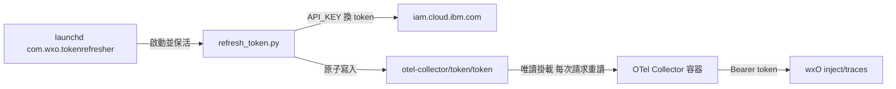

# Token 更新腳本常駐設定（launchd）

## 目的

wxO 的 trace 匯入端點使用 IBM Cloud IAM 發的 Bearer token，有效期只有 3600 秒。OTel Collector 的 `bearertokenauth` 會讀取 `otel-collector/token/token` 這個檔案，所以必須有程式持續把它換新。這份文件記錄如何用 macOS launchd 讓 [`otel-collector/refresh_token.py`](../otel-collector/refresh_token.py) 常駐執行。



## 腳本行為

| 項目 | 行為 |
|---|---|
| 讀取設定 | 從專案根目錄 `.env` 讀 `API_KEY`、`TOKEN_URL` |
| 取得 token | `POST TOKEN_URL`，`grant_type=urn:ibm:params:oauth:grant-type:apikey` |
| 寫入方式 | 在同一目錄建立暫存檔，再用 `os.replace` 原子取代；內容只有 token，不含結尾換行 |
| 更新時機 | 取得 token 後睡 `expires_in × 0.8` 秒（3600 秒的 token 約每 48 分鐘更新） |
| 失敗處理 | 保留舊 token 檔，每 30 秒重試 |
| 日誌 | 只記錄 host、長度、狀態碼與到期秒數，不輸出 token 或 API key |

常用參數：

| 參數 | 預設 | 說明 |
|---|---|---|
| `--once` | 關 | 取得一次後離開，用於手動驗證 |
| `--token-path` | `otel-collector/token/token` | token 檔位置 |
| `--env-file` | 自動找 `.env` | 指定 `.env` 路徑 |
| `--refresh-ratio` | `0.8` | 在有效期的幾成之後更新 |
| `--retry-interval` | `30` | 失敗後重試間隔（秒） |

## 安裝步驟

### 1. 確認前提

```bash
# 專案虛擬環境存在，且有 python-dotenv
.venv/bin/python -c "import dotenv; print('ok')"

# 手動跑一次，確認 token 能取得並寫入
.venv/bin/python otel-collector/refresh_token.py --once
```

### 2. 建立 plist

安裝到 `~/Library/LaunchAgents/com.wxo.tokenrefresher.plist`，內容如下：

```xml
<?xml version="1.0" encoding="UTF-8"?>
<!DOCTYPE plist PUBLIC "-//Apple//DTD PLIST 1.0//EN" "http://www.apple.com/DTDs/PropertyList-1.0.dtd">
<plist version="1.0">
<dict>
    <key>Label</key>
    <string>com.wxo.tokenrefresher</string>

    <key>ProgramArguments</key>
    <array>
        <string>/Users/allen/Library/CloudStorage/OneDrive-IBM/2026 2H/Wiwynn 緯穎/wxO/wxo-enablement/.venv/bin/python</string>
        <string>/Users/allen/Library/CloudStorage/OneDrive-IBM/2026 2H/Wiwynn 緯穎/wxO/wxo-enablement/otel-collector/refresh_token.py</string>
    </array>

    <key>WorkingDirectory</key>
    <string>/Users/allen/Library/CloudStorage/OneDrive-IBM/2026 2H/Wiwynn 緯穎/wxO/wxo-enablement</string>

    <key>RunAtLoad</key>
    <true/>

    <key>KeepAlive</key>
    <true/>

    <key>ThrottleInterval</key>
    <integer>30</integer>

    <key>StandardOutPath</key>
    <string>/Users/allen/Library/Logs/wxo-token-refresher.log</string>
    <key>StandardErrorPath</key>
    <string>/Users/allen/Library/Logs/wxo-token-refresher.log</string>

    <key>EnvironmentVariables</key>
    <dict>
        <key>PATH</key>
        <string>/usr/local/bin:/usr/bin:/bin:/usr/sbin:/sbin:/opt/homebrew/bin</string>
        <key>PYTHONUNBUFFERED</key>
        <string>1</string>
    </dict>
</dict>
</plist>
```

### 3. 載入服務

```bash
plutil -lint ~/Library/LaunchAgents/com.wxo.tokenrefresher.plist
launchctl bootstrap gui/$(id -u) ~/Library/LaunchAgents/com.wxo.tokenrefresher.plist
```

### 4. 驗證

```bash
# 狀態應為 running，last exit code 為 never exited
launchctl print gui/$(id -u)/com.wxo.tokenrefresher | grep -E 'state|pid|last exit|runs'

# 日誌應出現 Successfully fetched token 與 Next token refresh scheduled
tail -15 ~/Library/Logs/wxo-token-refresher.log

# token 檔時間應為剛剛，大小約 1439 bytes
stat -f '%Sm  mode=%Lp size=%z' otel-collector/token/token
```

## 與專案範本的差異

[`otel-collector/com.wxo.tokenrefresher.plist.template`](../otel-collector/com.wxo.tokenrefresher.plist.template) 是通用範本，實際安裝的版本有這些調整：

| 項目 | 範本 | 實際安裝 | 原因 |
|---|---|---|---|
| 啟動方式 | `uv run python otel-collector/refresh_token.py` | 直接呼叫 `.venv/bin/python <腳本絕對路徑>` | launchd 不需靠 PATH 找 `uv`，每次啟動也不用重新解析相依套件 |
| 日誌位置 | 專案內 `otel-collector/token_refresher.log` | `~/Library/Logs/wxo-token-refresher.log` | 避免日誌被 OneDrive 同步 |
| `ThrottleInterval` | 無 | `30` | 腳本異常結束時，限制 launchd 至少間隔 30 秒才重啟，避免快速重啟迴圈打爆 IAM |
| `PYTHONUNBUFFERED` | 無 | `1` | 日誌即時寫入，不被緩衝 |

範本中的路徑為佔位文字，換機器或換使用者時要全部替換成實際的絕對路徑。

## 維運

```bash
# 查看狀態
launchctl print gui/$(id -u)/com.wxo.tokenrefresher | grep -E 'state|pid'

# 停止並移除（改設定前先做）
launchctl bootout gui/$(id -u)/com.wxo.tokenrefresher

# 重新載入
launchctl bootstrap gui/$(id -u) ~/Library/LaunchAgents/com.wxo.tokenrefresher.plist

# 立即重啟（強制馬上換一次 token）
launchctl kickstart -k gui/$(id -u)/com.wxo.tokenrefresher

# 追蹤日誌
tail -f ~/Library/Logs/wxo-token-refresher.log
```

修改 plist 之後必須先 `bootout` 再 `bootstrap`，直接改檔案不會生效。

## 疑難排解

| 症狀 | 可能原因 | 處理 |
|---|---|---|
| `state` 不是 `running`，`last exit code` 非 0 | `.venv` 路徑變了、套件缺失 | 看日誌；手動跑 `--once` 重現 |
| 日誌出現 `HTTP error fetching token: HTTP 400/401` | `API_KEY` 失效或 `TOKEN_URL` 錯誤 | 檢查 `.env`，更新後 `kickstart -k` |
| 日誌出現 `Network/URL error` | 網路中斷 | 腳本會每 30 秒重試並保留舊 token，通常不需處理 |
| token 檔很久沒更新，Collector 轉送 wxO 回 401 | 服務沒在跑，或連續失敗超過 token 有效期 | 先確認服務狀態與日誌，再 `kickstart -k` |
| 日誌有 `python-dotenv could not parse statement starting at line N` | `.env` 該行不是 `KEY=VALUE` 格式 | 不影響運作；整理 `.env` 刪掉殘留行即可 |

## 已知限制與注意事項

- **服務跟隨使用者登入。** 這是 LaunchAgent（`gui/<uid>`），使用者登出後會停止，重新登入後才會啟動。若要在登出時也運行，需改成 LaunchDaemon，但會牽涉 `.env` 讀取權限，目前沒有這個需求。
- **token 檔位於 OneDrive 同步資料夾內。** `.gitignore` 只擋 git，擋不住 OneDrive 把 `otel-collector/token/token` 同步到雲端。實測 `stat` 顯示檔案權限為 700（腳本設的是 600），推測是 OneDrive 資料夾的檔案系統行為。若要避免機密同步，可改放到 `~/.wxo-otel/token/`，並同步修改 `--token-path`（plist 的 `ProgramArguments`）與 `otel-collector/compose.yaml` 的 token 掛載路徑。
- **專案路徑含空格與中文。** launchd 的 `ProgramArguments` 每個元素是獨立字串，不需要額外跳脫，路徑可以直接寫。
- **`.venv` 被重建後要確認 `python` 路徑。** 目前 `.venv/bin/python` 是指向 uv 管理的 Python 3.12 的符號連結。
- **Podman 與 Collector 的開機自動啟動不在這份文件範圍內**，尚未驗證，請見計畫檔 [`hermes-otel-to-wxo-plan.md`](../hermes-otel-to-wxo-plan.md) 子任務 3 的已知限制。

## 相關檔案

| 檔案 | 說明 |
|---|---|
| [`otel-collector/refresh_token.py`](../otel-collector/refresh_token.py) | token 更新腳本 |
| [`otel-collector/com.wxo.tokenrefresher.plist.template`](../otel-collector/com.wxo.tokenrefresher.plist.template) | launchd 範本（含佔位路徑） |
| `~/Library/LaunchAgents/com.wxo.tokenrefresher.plist` | 實際安裝的服務定義 |
| `~/Library/Logs/wxo-token-refresher.log` | 服務日誌 |
| `otel-collector/token/token` | 產出的 token 檔（已被 `.gitignore` 排除） |
| [`otel-collector/compose.yaml`](../otel-collector/compose.yaml) | Collector 以唯讀方式掛載 token 目錄 |
| [`hermes-otel-to-wxo-plan.md`](../hermes-otel-to-wxo-plan.md) | 整體計畫與各子任務交接資訊 |
