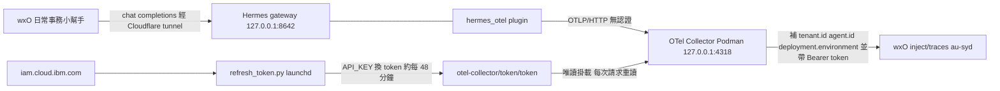

# Hermes trace → wxO 整合：目前狀態、驗證結果與洞察

> 這份文件是為了在上下文壓縮前保存資訊。它整理截至 2026-11-02 18:50（UTC+8）的所有事實、使用者回報、已驗證與**未驗證**的項目。
> 詳細的子任務計畫與交接資訊在 [`hermes-otel-to-wxo-plan.md`](../hermes-otel-to-wxo-plan.md)；本文件偏重「發生了什麼、學到什麼、還剩什麼」。
> 標示「已驗證」的項目都有實際輸出或使用者在 UI 的回報支持；標示「推論」或「未驗證」的項目請不要當成事實。

## 1. 目標與最終架構

**目標**：把本機 Hermes Agent 的執行 trace 送進 wxO 的 Agent Analytics。依 [`WXO_External_Agent_Observability_Guide.pdf`](WXO_External_Agent_Observability_Guide.pdf) 的 **Option 1（Generic OpenTelemetry Export）**，搭配 Hermes 的社群 plugin `hermes_otel`（v1.18.2）。



**為什麼要中介 Collector**（使用者已同意）：
1. wxO 的認證是用 `API_KEY` 向 `TOKEN_URL` 換 Bearer token，token 3600 秒就過期，而 Hermes gateway 長時間執行；hermes_otel 文件只看到靜態 `api_key` / `${VAR}`，沒看到動態換 token 的機制。
2. wxO 需要 `tenant.id`（實測 wxO 回 `Missing tenant.id on spans`）、`agent.id`、`deployment.environment`，plugin 預設不帶，由 Collector 統一補。

## 2. 關鍵事實（使用者提供）

| 項目 | 內容 |
|---|---|
| wxO 上的 Hermes agent 名稱 | `allen-hermes-test` |
| 其 Agent ID | `9da1a55f-ccd9-405f-b363-79b69d2f4fdf`（使用者在 wxO UI 手動建立，寫在 `.env` 的 `AGENT_ID`） |
| 綁定的主 agent | **日常事務小幫手**，ID `a6ce287c-d739-4dc6-a53c-028e7a9fa634` |
| 使用者實際對話的對象 | 日常事務小幫手；由小幫手去呼叫 `allen-hermes-test`（Hermes） |
| wxO 與 Hermes 的連接方式 | **OpenAI-compatible Chat Completions**（`/v1/chat/completions`，Hermes `api_server` 平台，port 8642，經 Cloudflare quick tunnel；網址記在 [`chat completion url.md`](chat%20completion%20url.md)）。**不是 A2A** |
| wxO UI 位置 | `au-syd.watson-orchestrate.cloud.ibm.com` → Analytics → `allen-hermes-test` |
| content_capture | 使用者決定維持 `full`（完整 prompt 與回應都送進 wxO） |
| Collector 部署方式 | Podman（`otel/opentelemetry-collector-contrib:0.164.0`） |
| 設定值來源 | 全部從專案根目錄 `.env` 讀取：`TENANT_ID`、`AGENT_ID`、`ENVIRONMENT_NAME`（`draft`）、`OTEL_EXPORT_URL`、`API_KEY`、`TOKEN_URL`（`.env` 已被 `.gitignore` 排除） |
| 開機自動啟動 | 使用者決定**不處理**，改為手動啟動，流程見 [`重開機後手動啟動流程.md`](重開機後手動啟動流程.md) |

### 我曾經搞錯的地方（已更正）
- 我先前看到 `~/.hermes/config.yaml` 有 `a2a.trusted_peers: [wxo]`，就誤以為 wxO 與 Hermes 走 A2A，並把「A2A 路徑尚未驗證」列成待辦。使用者糾正：現在是 OpenAI-compatible chat API。證據也支持：trace 的 `llm.api_mode = chat_completions`、`session.id = api-<hash>`、`hermes.platform = api_server`。A2A（port 9900）雖然開著，但不在這次範圍。

## 3. 已建立的元件與位置

| 元件 | 位置 | 說明 |
|---|---|---|
| 計畫檔 | [`hermes-otel-to-wxo-plan.md`](../hermes-otel-to-wxo-plan.md) | 六個子任務與各自交接資訊 |
| token 更新腳本 | [`otel-collector/refresh_token.py`](../otel-collector/refresh_token.py) | IAM API key 換 token，原子寫入，失敗保留舊 token 並每 30 秒重試 |
| launchd 範本 | [`otel-collector/com.wxo.tokenrefresher.plist.template`](../otel-collector/com.wxo.tokenrefresher.plist.template) | 路徑為佔位文字 |
| 實際安裝的服務 | `~/Library/LaunchAgents/com.wxo.tokenrefresher.plist` | 直接呼叫 `.venv/bin/python`；日誌 `~/Library/Logs/wxo-token-refresher.log` |
| Collector 設定 | [`otel-collector/config.yaml`](../otel-collector/config.yaml) | otlp receiver、resource + attributes processor、`bearertokenauth`（`filename`）、`otlphttp/wxo` exporter、debug exporter |
| Collector compose | [`otel-collector/compose.yaml`](../otel-collector/compose.yaml) | 容器名 `wxo-otelcol`，port 只發佈 `127.0.0.1:4318`，只注入 `TENANT_ID`、`AGENT_ID`、`ENVIRONMENT_NAME`、`OTEL_EXPORT_URL`（**刻意不注入 `API_KEY`、`TOKEN_URL`**） |
| token 檔 | `otel-collector/token/token` | 純 JWT、無結尾換行；已被 `.gitignore` 排除 |
| hermes_otel 設定 | `~/.hermes/hermes_otel.yaml` | `type: otlp`，`endpoint: http://127.0.0.1:4318/v1/traces`，`metrics: false`、`logs: false`，`content_capture: full`，`project_name: hermes-agent` |
| `.env.example` | [`.env.example`](../.env.example) | 不含機密的範本 |
| 其他文件 | [`token 更新腳本常駐設定.md`](token%20更新腳本常駐設定.md)、[`重開機後手動啟動流程.md`](重開機後手動啟動流程.md)、[`確認 hermes api server 活著.md`](確認%20hermes%20api%20server%20活著.md)、[`啟動 Cloudflare quick tunnel.md`](啟動%20Cloudflare%20quick%20tunnel.md) | |

**執行環境細節**
- Hermes 的 Python：`/Users/allen/.hermes/tools/python-3.14.9+20261021-darwin-arm64/bin/python3`；hermes_otel 需要的 OpenTelemetry 套件是**手動 pip 安裝**進去的。
- Podman 5.8.2（Homebrew），machine `podman-machine-default`（applehv，rootless），VM 內 Podman 5.6.2。`podman compose` 實際使用 `/opt/homebrew/bin/podman-compose`。
- 專案位於 OneDrive 路徑（含空格與中文）。實測 Podman 掛載該路徑**可行**，token 更新後容器不重啟即生效。
- 專案 `.venv` 使用 uv 管理的 Python 3.12；`pyproject.toml` 已有 `python-dotenv`、`requests`。

## 4. 驗證結果

### 4.1 Collector 與 token（已驗證）
- `TOKEN_URL`（`iam.cloud.ibm.com/identity/token`）回 HTTP 200，`expires_in = 3600`，認證類型為 **Bearer**（不是 MCSP_v2 或 x-api-key）。
- 用該 token 對 `OTEL_EXPORT_URL` 送請求，不帶 `tenant.id` 時回 `400 Missing tenant.id on spans`；由 Collector 補上 `tenant.id` 後回 `200 {"partialSuccess":{}}`。
- `bearertokenauth` 的 `filename` 每次請求重讀 token 檔：執行 `refresh_token.py --once` 後不重啟容器，連續兩次請求均 200。
- 容器內環境變數只有四個必要變數，沒有 `API_KEY`、`TOKEN_URL`；Collector 日誌沒有 token 外洩（已檢查 `authorization`、token 前 40 字元，皆 0 筆）。
- 掛載 OneDrive 路徑：成功，hash 驗證一致。

### 4.2 第一次端對端（PoC，本機直接打 `127.0.0.1:8642`）
- 使用者在 wxO UI 看到對話 `api-74e29270d33adf91`，內容「請用一句話自我介紹」，Agent 回覆「我是Hermes Agent，一個能夠幫助您完成各種任務的AI助手。」。
- Trace ID `e8d2e43b80f3e4bae5b57862b26fff2a`：input 6,309 / output 78 / total 6,387 tokens，9.83 秒，model `llama-3-3-70b-instruct`。
- span 樹：`agent`（9.83s）→ `llm.llama-3-3-70b-instruct`（9.82s）→ `api.*`（6.22s，2,888 tokens）→ `web_search`（1.00s）→ `api.*`（2.50s，3,499 tokens）。
- wxO 把 `api.*` 識別為 **GENERATION**，解析出 Model、Unit（TOKENS）、input/output tokens、Input/Output 內容。
- 該 `api.*` span 的 attribute 帶 `agent.id`、`tenant.id`；Resource Attributes 帶 `tenant.id`、`deployment.environment: draft`、`service.name: hermes-agent`、`service.version: 1.18.2`、`hermes.profile: default`、`openinference.project.name: hermes-agent`；Scope 為 `hermes-otel-plugin`。
- **結論：wxO 只需 `agent.id`、`tenant.id`、`deployment.environment` 就能顯示 Hermes 的 trace，不需要 `langfuse.*` 欄位。**

### 4.3 第二次端對端（真實路徑：使用者對日常事務小幫手說話，小幫手呼叫 Hermes）
- Collector 在 10:41 UTC（18:41 UTC+8）收到新 trace，**沒有任何 exporter 的 error 或 warn**。
- Trace ID `ce85f5dbd82a5284da2bb3d0d767c5e1`，session `api-0796046039c2303f`，`hermes.platform = api_server`，`llm.api_mode = chat_completions`。
- span 樹：`agent` → `llm.*` → `api.*`（約 4.0s，prompt 2,913 / completion 45）→ `tool.web_search`（約 2.0s，outcome completed）→ `api.*`（約 2.7s，prompt 4,563 / completion 37）。總計約 8.8 秒，agent 層 prompt 7,476 / completion 82 / total 7,558。
- **Hermes 收到的使用者訊息是 `hello`**，並呼叫 `web_search(query="hello", limit="5")`。
- 使用者在 `allen-hermes-test` → Conversations 看到 `api-0796046039c2303f`：User 訊息 `hello`，Agent 的 **Show Reasoning** 展開後有 Step 1：Tool `web_search`，Input `{"query":"hello","limit":"5"}`，Output 是完整搜尋結果（Cambridge Dictionary 等）。畫面末尾還出現模型自己產生的一段文字：`The function call with its proper arguments that best answers the given prompt is: {"name": "web_search", ...}`（這是模型輸出的樣子，原因未調查）。
- **使用者在「日常事務小幫手」那次對話的 trace view 裡，只有 wxO 自己的 span，沒有 Hermes 的 span。**

## 5. 洞察（Insights）

1. **整合已能運作，但產出的是兩條獨立的 trace。** 小幫手呼叫 Hermes 時，wxO 端的 trace（在「日常事務小幫手」底下）和 Hermes 的 trace（在 `allen-hermes-test` 底下）彼此沒有串在一起。Hermes 的 span 是用 Hermes 自己產生的 trace ID 與 `api-<hash>` session，Collector 沒有收到任何能把它掛到小幫手 trace 的資訊。
2. **這個「分開」是從現象推論的，原因未確認。** 我沒有檢查過 wxO 呼叫外部 chat completions 時有沒有送 `traceparent`、對話 ID 或其他可關聯的標頭，也沒有在 Hermes 端記錄進來的 HTTP 標頭。**不要假設能跨 agent 串接。**
3. **Hermes 的 `agent.id` 是固定的 `allen-hermes-test`。** 不論是誰呼叫（本機 curl、wxO 小幫手），trace 都歸到 `allen-hermes-test`，沒辦法區分來源。兩次測試的 `hermes.platform` 都是 `api_server`，沒有區別。
4. **session 是 Hermes 自己的 `api-<hash>`，不是 wxO 的對話 ID。** 如果之後想把 Hermes 的對話對應回小幫手的對話，需要找到 wxO 有沒有把對話 ID 傳進來（尚未調查）。
5. **wxO 的 Analytics 對不同 span 的呈現不同。**
   - Trace view：只有 `api.*` 被識別為 `GENERATION`；`agent`、`llm.*`、`web_search` 顯示為一般 span。
   - Conversations：`web_search` 被當成「Show Reasoning」裡的 Step（Tool、Input、Output），**工具呼叫資訊有被解析出來**。
   - 所以先前我記錄的「`web_search` 沒被當成 tool」只對 Trace view 成立，Conversations 視圖是有的。
6. **User 欄位為 `Unknown`。** Hermes 沒送 `langfuse.user.id`（hermes_otel 也沒有 `langfuse.session.id` / `langfuse.user.id`）。這不影響 trace 顯示，但使用者識別缺失。
7. **`content_capture: full` 的副作用有兩個：** 完整 prompt（含數 KB 的 system prompt）與工具結果都進了 wxO；而 Collector 的 debug exporter 是 `verbosity: detailed`，同樣把內容明文寫進 `podman logs`。
8. **LLM 成本顯示未知**：`hermes.cost.status = unknown`、`hermes.cost.source = none`。

## 6. 還沒驗證／未解決的項目

| # | 項目 | 狀態 | 備註 |
|---|---|---|---|
| 1 | **跨 agent trace 串接**（把 Hermes 的 span 掛到小幫手的 trace 下） | 文件查過，**無依據**；實測未做 | 2026-11-02 查過：wxO ADK 文件（`/agents/connect_agent`、`/traces/otel-export`、API 參考）與 GitHub 外部 agent 規格 README，**都沒有提到** wxO 呼叫 external_chat agent 時會送 `traceparent`。文件只看到 `thread_id` 出現在回應的 SSE 資料裡，以及 wxO 自己的 chat API 有 `X-IBM-THREAD-ID` 請求標頭（那是使用者端呼叫 wxO 用，不是 wxO 呼叫外部 agent 用）。Hermes 端我查了 `api_server*.py`，只讀 `X-Hermes-Session-Id`／`X-Hermes-Session-Key`，沒有讀 `traceparent`；hermes_otel 的 `propagation.py` 只負責「往外」送給 MCP，不處理「從 API 進來」的 context。**結論：目前沒有證據顯示能串接。**「文件沒寫」不等於「wxO 不送」，要確定需在 Hermes 端暫時記錄進來請求的標頭（不可記 Authorization）實測 |
| 2 | 小幫手轉給 Hermes 的內容為何是 `hello` | 未確認 | 使用者沒有說明自己對小幫手說了什麼。無法判斷是小幫手改寫了內容，還是 10:41 其實是別的測試 |
| 3 | token 自動換新後 trace 仍持續進入 wxO | 換新已驗證；換新後送資料未驗證 | 18:55:55 已自動換新（日誌：fetch 成功、原子寫入、下次 48 分鐘後），token 檔仍為 mode 600。Collector 日誌目前唯一的 warn 是 `otlphttp` deprecated，無 401/403。**但換新後尚未再對話一次**，所以「新 token 能成功送進 wxO」仍待實測 |
| 4 | User 欄位 `Unknown` | 待決定 | 要不要加 `langfuse.user.id`、用什麼值，需使用者決定 |
| 5 | Collector debug exporter 降級 | 待使用者同意 | 目前 `detailed` 會把 prompt 與工具結果寫入 `podman logs`；建議改 `basic` 或移除，**我還沒改** |
| 6 | Analytics Overview 的數字可能含測試 span | 未確認 | 子任務 3 曾送出 `collector-smoke-test`、`token-hotreload-test`，用的是同一個 `agent.id` |
| 7 | 開機後的自動啟動 | 使用者決定手動 | token 更新服務、Hermes gateway、Podman machine、`wxo-otelcol` 容器，**全部沒有實際重開機驗證** |
| 8 | 子任務 6 收尾 | 未做 | 啟動順序文件、機密檢查、已知限制整理 |
| 9 | `otlphttp` → `otlp_http` | 未做 | 0.164.0 對舊別名顯示 deprecated 警告，不影響功能 |

## 7. 踩過的坑與注意事項

- **安裝名稱**：要用 `hermes plugins install hermes_otel`（底線，catalog 名稱）。用連字號 `hermes-otel` 會裝到 repo 根目錄而非 plugin 子目錄。安裝後還要 `hermes plugins enable hermes_otel`。
- **OpenTelemetry 套件**：`plugins enable` 回報套件不可用，手動 pip 安裝進 Hermes 的 Python。文件說 Hermes 0.21+ 會在 `hermes update` 後自動重裝，但**未實測**；若更新後 trace 突然消失，先檢查這點。
- **gateway 重啟**：`hermes gateway restart` 在前景執行，PoC 時造成 gateway 停掉後沒有自動拉回，需再 `hermes gateway start`。
- **gateway 的 launchd 狀態有疑點**：`launchctl list` 顯示 `ai.hermes.gateway` 沒有 PID、上次退出碼 75；實際在跑的 gateway（PID 36071，父程序 1，監聽 `127.0.0.1:8642` 與 `*:9900`）是否由這個 launchd 項目啟動，**不確定**。該 plist 還有 `LimitLoadToSessionType = Aqua`。
- **`.env` 的第 1、2 行** 是殘留的 Hermes token 文字（不是 `KEY=VALUE`），會讓 python-dotenv 報解析警告；`source .env` 時其中的單引號也可能出錯。建議清掉。
- **zsh 與 bash**：`${!var}` 間接展開是 bash 語法，在 zsh 會出 `bad substitution`；zsh 要用 `${(P)var}`。
- **`podman compose` 必須先 `source .env`**：compose 檔用 `VAR:` 繼承主機環境，沒載入時容器會收到空字串。
- **token 檔在 OneDrive 同步資料夾裡**：`.gitignore` 擋不住 OneDrive 同步；`stat` 顯示權限為 700（腳本設的是 600），推測是 OneDrive 資料夾的行為。若在意機密，可改放 `~/.wxo-otel/token/` 並同步修改 `--token-path` 與 compose 的掛載路徑。使用者已決定先維持現狀。
- **Hermes plugin 的 `type: otlp`**：`endpoint` 需要完整 URL（含 `/v1/traces`），不會自動補路徑。
- **hermes_otel 依 span 類型分批送出**：一次對話在 Collector 看到 3 個 ResourceSpans。
- **Cloudflare quick tunnel 網址每次啟動都會變**，`chat completion url.md` 內的網址可能已失效。

## 8. 建議的下一步（尚未執行，依優先順序）

1. **先查 wxO 呼叫外部 chat completions agent 時送了哪些標頭／欄位**：到 wxO ADK 文件搜尋（外部 agent、chat completions、thread id、traceparent），並在 Hermes 端暫時記錄進來請求的標頭（注意不要記錄 Authorization）。再判斷跨 agent 串接是否可行。
2. 確認第 2 項：問清楚使用者對小幫手說了什麼，與 Hermes 收到的 `hello` 是否一致。
3. 18:55 之後 token 換新，再對話一次，確認 trace 仍持續進入 wxO（驗證項目 3）。
4. 經使用者同意後，把 Collector 的 debug exporter 降為 `basic`（項目 5），並修正 `.env` 前兩行。
5. 決定 User 欄位怎麼處理（項目 4）。
6. 完成子任務 6 收尾。

## 9. 常用指令速查

```bash
# Collector 狀態與 smoke test
podman ps --filter name=wxo-otelcol --format '{{.Names}} {{.Status}}'
curl -s -o /dev/null -w 'HTTP %{http_code}\n' -X POST -H 'Content-Type: application/json' -d '{}' http://127.0.0.1:4318/v1/traces

# 看 Collector 收到的 trace id 與 session
podman logs wxo-otelcol 2>&1 | grep -E 'Trace ID|session.id' | sort | uniq -c

# 看轉送 wxO 有沒有錯誤
podman logs --since 15m wxo-otelcol 2>&1 | grep -E '	(error|warn)	'

# token 更新服務
launchctl print gui/$(id -u)/com.wxo.tokenrefresher | grep -E 'state =|pid ='
stat -f 'token updated: %Sm' otel-collector/token/token
tail -10 ~/Library/Logs/wxo-token-refresher.log

# Hermes
hermes gateway status
hermes plugins list | grep hermes_otel
```
