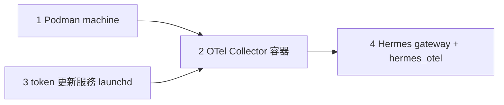

# Hermes trace → wxO：重開機後手動啟動流程

整條 trace 管線有四個元件。**重開機（或登出再登入）之後，不要假設任何一個元件已經正常運作，請依下列順序逐一檢查，發現錯誤再處理。** 下表只區分「有沒有設定自動啟動」，這些都是從設定檔查到的，**沒有一項是實際重開機後驗證過的**。



## 各元件開機後的預期狀態

| 元件 | 有設定自動啟動嗎 | 查到的依據 | 是否實際驗證過 |
|---|---|---|---|
| token 更新服務 `com.wxo.tokenrefresher` | 有設定 | LaunchAgent，`RunAtLoad` + `KeepAlive` | 只驗證過「手動 bootstrap 後會執行並換新 token」，**未驗證重開機後自動啟動** |
| Hermes gateway | 有設定 | `~/Library/LaunchAgents/ai.hermes.gateway.plist`，`RunAtLoad`、`KeepAlive`，且 `LimitLoadToSessionType = Aqua`（需圖形介面登入）。但 `launchctl list` 顯示該服務沒有 PID、上次退出碼 75，而實際在跑的 gateway 程序父程序為 1，**不能確定它是由這個 launchd 項目啟動的** | **未驗證** |
| Podman machine | 沒有 | 本機沒有 Podman 的 launchd 項目；Podman Desktop 的 `preferences.login.start` 為 `false`，登入項目裡也沒有它 | 依設定判斷，未實際重開機確認 |
| `wxo-otelcol` 容器 | 沒有 | 容器設了 `restart: unless-stopped`，但 VM 內的 `podman-restart.service` 是 disabled，且該服務只拉起 `restart-policy=always` 的容器 | 依設定判斷，未實際重開機確認 |

換句話說，**表中任何一列都可能和實際情況不同**。以步驟中的檢查指令為準，不要以這張表為準。

只要 Collector 沒起來，Hermes 的 trace 就送不到 `127.0.0.1:4318`。plugin 文件說明 hooks 採 fail open、span 匯出在獨立執行緒、不會阻塞 agent，所以預期不會中斷 Hermes 本身的運作，但這是依文件推論，**本機沒有實際關掉 Collector 測試過**；如果發現 Hermes 在 Collector 停止時變慢或出錯，請回報並檢查 `~/.hermes/logs/gateway.error.log`。

## 啟動步驟

在專案根目錄執行（`cd` 到 `wxo-enablement`）。

### 1. 啟動 Podman machine

```bash
podman machine start
podman machine list        # 確認 podman-machine-default 為 Currently running
```

### 2. 確認 token 檔是新的

token 有效期 3600 秒。Mac 睡眠或關機超過一小時，token 檔就已過期。token 更新服務若有正常啟動，會在啟動時立刻重新取得；但不要假設它已經啟動，Collector 啟動前先確認：

```bash
launchctl print gui/$(id -u)/com.wxo.tokenrefresher | grep -E 'state =|pid ='
stat -f 'token updated: %Sm' otel-collector/token/token; date
```

- `state = running` 且 token 更新時間在一小時內：正常。
- token 更新時間超過一小時，或服務沒在跑：

```bash
launchctl kickstart -k gui/$(id -u)/com.wxo.tokenrefresher   # 立即重啟並換新 token
tail -5 ~/Library/Logs/wxo-token-refresher.log
```

服務若不存在，請看 [`docs/token 更新腳本常駐設定.md`](token%20更新腳本常駐設定.md) 重新載入。

### 3. 啟動 Collector 容器

容器已存在（只是停止狀態）時，直接啟動：

```bash
podman start wxo-otelcol
```

容器被刪除或不存在時，需要重新建立，並且**必須先把 `.env` 載入目前的 shell**，因為 [`otel-collector/compose.yaml`](../otel-collector/compose.yaml) 只傳 `TENANT_ID`、`AGENT_ID`、`ENVIRONMENT_NAME`、`OTEL_EXPORT_URL` 四個變數，刻意不傳 `API_KEY` 與 `TOKEN_URL`：

```bash
set -a && source .env && set +a
podman compose -f otel-collector/compose.yaml up -d
```

注意事項：

- 沒有先 `source .env`，容器會收到空字串，Collector 轉送時會失敗。
- `.env` 第 1、2 行如果還有殘留的 Hermes token 文字（含單引號），`source .env` 可能報錯或讀不到後面的變數。請先清掉那兩行，或改用只載入需要的變數。
- `podman compose` 實際使用的是 `/opt/homebrew/bin/podman-compose`。

### 4. 驗證 Collector

```bash
podman ps --filter name=wxo-otelcol --format '{{.Names}} {{.Status}}'
curl -s -o /dev/null -w 'HTTP %{http_code}\n' -X POST \
  -H 'Content-Type: application/json' -d '{}' http://127.0.0.1:4318/v1/traces
```

預期容器為 `Up`，curl 回 `HTTP 200`。

再看日誌有沒有錯誤：

```bash
podman logs --since 5m wxo-otelcol 2>&1 | grep -E '	(error|warn)	'
```

目前正常情況下只會有一則 `"otlphttp" alias is deprecated` 的警告。

### 5. 確認 Hermes 有送出 trace

先確認 gateway 真的在跑，不要只看 `hermes gateway status` 的輸出：

```bash
hermes gateway status
launchctl list | grep ai.hermes.gateway     # 第一欄是 PID；"-" 表示 launchd 沒有在管這個程序
lsof -nP -iTCP:8642 -sTCP:LISTEN            # 應有 python 程序在監聽
tail -20 ~/.hermes/logs/gateway.error.log   # 看有沒有新的 ERROR
hermes plugins list | grep hermes_otel      # 應為 enabled
```

如果 gateway 沒起來或剛重啟過，可用 `hermes gateway start`（背景）；`hermes gateway restart` 在前景執行，曾在 PoC 時造成 gateway 被停掉後沒有自動拉回，需要再執行 `hermes gateway start`。

對 Hermes 說一句話後，到 wxO 的 **Analytics → `allen-hermes-test` → Conversations** 確認對話出現。也可以用 Collector 日誌確認收到：

```bash
podman logs --since 2m wxo-otelcol 2>&1 | grep -E '^\s+Name\s+:' | sort | uniq -c
```

應看到 `agent`、`llm.*`、`api.*`，有用工具時還有 `tool.*`。

## 常見問題

| 症狀 | 原因 | 處理 |
|---|---|---|
| `podman: Cannot connect to Podman` | Podman machine 沒啟動 | 步驟 1 |
| `podman start wxo-otelcol` 回 `no such container` | 容器已被刪除 | 步驟 3 的 `compose up -d` |
| 容器啟動了，但 Collector 日誌出現 `401` 或 `403` | token 檔過期或不存在 | 步驟 2，之後 `podman restart wxo-otelcol` 通常不需要，`bearertokenauth` 每次請求會重讀 token 檔 |
| Collector 日誌出現 `400 Missing tenant.id` | 容器沒收到環境變數 | 先 `source .env` 再 `compose up -d --force-recreate` |
| curl 4318 連不上 | 容器沒在跑，或 port 沒發佈 | `podman ps` 看 `127.0.0.1:4318->4318` |
| Hermes 回應正常但 wxO 沒資料 | Collector 沒起來、plugin 沒啟用，或套件被 `hermes update` 洗掉 | 依序檢查步驟 4、5；`hermes update` 之後 hermes_otel 需要的 OpenTelemetry 套件若遺失，要重裝，見 [`hermes-otel-to-wxo-plan.md`](../hermes-otel-to-wxo-plan.md) 子任務 4 的交接資訊 |

## 停止與清理

```bash
podman stop wxo-otelcol                                   # 停止，保留容器
podman compose -f otel-collector/compose.yaml down        # 停止並刪除容器
launchctl bootout gui/$(id -u)/com.wxo.tokenrefresher     # 停止 token 更新服務
```

## 未來想改成自動啟動時

目前選擇維持手動。若之後要自動化，可評估的做法（尚未實作，也沒有驗證）：

1. 新增一個 launchd 項目，登入時啟動 podman machine，VM 可用後執行 `podman start wxo-otelcol`。這個做法不動 VM 內部設定，也不影響 `litellm-watsonx-ai-proxy_litellm_1` 等其他容器。
2. 啟用 VM 內的 `podman-restart.service`，並把容器的 restart 設為 `always`。注意該服務只會拉起 `restart-policy=always` 的容器，`unless-stopped` 不在它的過濾條件內；這會改變 VM 設定，也會影響其他容器。

## 相關檔案

| 檔案 | 說明 |
|---|---|
| [`otel-collector/compose.yaml`](../otel-collector/compose.yaml) | Collector 容器定義 |
| [`otel-collector/config.yaml`](../otel-collector/config.yaml) | Collector 設定 |
| [`docs/token 更新腳本常駐設定.md`](token%20更新腳本常駐設定.md) | token 更新服務的安裝與維運 |
| [`hermes-otel-to-wxo-plan.md`](../hermes-otel-to-wxo-plan.md) | 整體計畫與交接資訊 |
| `~/Library/Logs/wxo-token-refresher.log` | token 更新服務日誌 |
